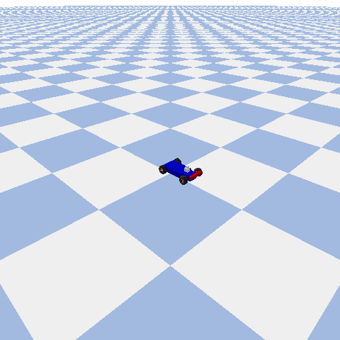

# Smooth-Cargo Transit: Acceleration-Constrained Continuous Control via Deep RL



> A continuous control Reinforcement Learning pipeline designed to navigate a 3D mobile vehicle to a target location in minimum time while suppressing sudden acceleration spikes to protect delicate or liquid cargo.

---

## Table of Contents
- [1. Overview & Problem Formulation](#1-overview--problem-formulation)
- [2. System Architecture](#2-system-architecture)
- [3. Mathematical MDP Framework](#3-mathematical-mdp-framework)
  - [State Space](#state-space)
  - [Action Space](#action-space)
  - [Reward Shaping](#reward-shaping)
- [4. Codebase Explanation](#4-codebase-explanation)
  - [`cargo_env.py`](#cargo_envpy)
  - [`train.py`](#trainpy)
- [5. Installation & Setup](#5-installation--setup)
- [6. Running the Simulation & Training](#6-running-the-simulation--training)
- [7. Future Extensions](#7-future-extensions)

---

## 1. Overview & Problem Formulation

Standard autonomous motion planners and unconstrained Reinforcement Learning (RL) agents prioritize time-optimality. Consequently, they often execute abrupt throttle bursts and hard braking maneuvers. While effective for standard point-to-point transit, high acceleration and jerk produce severe inertial forces ($F = m \cdot a$) that cause liquid spillage or cargo damage.

This project implements **Constrained Reinforcement Learning for Cargo Protection**, where an agent learns to optimize trade-offs between two competing objectives:
1. **Goal-Directed Navigation:** Minimize distance to target coordinates as fast as possible.
2. **Acceleration Constraints:** Smooth out throttle and steering commands to minimize step-wise acceleration derivatives.

---

## 2. System Architecture

- **Physics Simulator:** [PyBullet 3D](https://pybullet.org/) (Real-time rigid body physics with Ackermann steering mechanics).
- **Environment Interface:** [Gymnasium](https://gymnasium.farama.org/) (Standardized OpenAI Gym API).
- **Learning Algorithm:** Proximal Policy Optimization (PPO) via [Stable-Baselines3](https://stable-baselines3.readthedocs.io/).
- **Language:** Python 3.9+

---

## 3. Mathematical MDP Framework

The control task is modeled as a continuous **Markov Decision Process (MDP)** defined by $\mathcal{M} = (\mathcal{S}, \mathcal{A}, \mathcal{P}, \mathcal{R}, \gamma)$.

### State Space ($\mathcal{S} \in \mathbb{R}^6$)
At step $t$, the observation vector consists of:
$$\mathbf{s}_t = \begin{bmatrix} x_t & y_t & \Delta x_t & \Delta y_t & v_t & \omega_t \end{bmatrix}^T$$

| Component | Description | Unit |
| :--- | :--- | :--- |
| $x_t, y_t$ | Robot global 2D position | meters ($m$) |
| $\Delta x_t, \Delta y_t$ | Distance vector to target marker ($x_{\text{goal}} - x_t, y_{\text{goal}} - y_t$) | meters ($m$) |
| $v_t$ | Planar linear speed $\|\mathbf{v}_{xy}\|_2$ | $m/s$ |
| $\omega_t$ | Yaw rate / angular velocity around vertical $Z$-axis | $rad/s$ |

### Action Space ($\mathcal{A} \in \mathbb{R}^2$)
The continuous action space dictates low-level motor commands bounded to physical joint hardware limits:
$$\mathbf{a}_t = \begin{bmatrix} \delta_t & \dot{\theta}_t \end{bmatrix}^T$$

- **Steering Angle ($\delta_t$):** Bounded within $[-0.5, 0.5]$ radians. Controls front wheel steering hinges (Joints `[0, 2]`).
- **Throttle Velocity ($\dot{\theta}_t$):** Bounded within $[-5.0, 20.0]$ rad/s. Controls rear wheel motor velocities (Joints `[3, 5, 7]`).

### Reward Shaping ($\mathcal{R}$)
The agent is guided by a composite multi-objective scalar reward function:

$$R_t = -\underbrace{\|\mathbf{p}_{\text{goal}} - \mathbf{p}_{\text{robot}}\|_2}_{\text{Progress Drive}} - \underbrace{\beta \cdot a_t}_{\text{Cargo Penalty}} + \underbrace{R_{\text{goal}}}_{\text{Terminal Bonus}}$$

Where:
- $a_t = \frac{|v_t - v_{t-1}|}{\Delta t}$ is the numerical derivative of speed (acceleration proxy).
- $\beta = 0.1$ is the cargo protection hyperparameter.
- $R_{\text{goal}} = +100$ when $\|\mathbf{p}_{\text{goal}} - \mathbf{p}_{\text{robot}}\|_2 < 0.5m$.

---

## 4. Codebase Explanation

### `cargo_env.py`
This module defines the custom 3D Gymnasium environment `CargoDelivery3DEnv`:
- **`__init__()`**: Initializes PyBullet physics server connections (GUI or DIRECT modes), action/observation spaces, goal position, and joint index mappings for Ackermann vehicle control.
- **`reset()`**: Re-initializes rigid bodies (ground plane, racecar model, red target sphere), resets motor velocity states, and resets step counters.
- **`step(action)`**: 
  1. Applies continuous steering positions and wheel throttle motor commands via `p.setJointMotorControl2`.
  2. Advances rigid-body physics simulation step (`p.stepSimulation()`).
  3. Computes instantaneous speed and acceleration proxy $a_t$.
  4. Calculates step reward $R_t$ and checks termination bounds.
- **`_get_obs()`**: Reads base positions, global velocities, and relative target distances directly from the physics engine.

### `train.py`
This script executes the model learning and deployment pipeline:
1. **Training Phase:** Instantiates `CargoDelivery3DEnv` in headless (`DIRECT`) mode and trains a PPO MLP Actor-Critic policy for 40,000 steps.
2. **Model Preservation:** Exports trained weights to `ppo_cargo_robot.zip`.
3. **Inference Phase:** Instantiates visual (`GUI`) mode and runs the deterministic policy live for evaluation.

---

## 5. Installation & Setup

1. **Clone the repository:**
   ```bash
   git clone [https://github.com/YOUR_USERNAME/Smooth-Cargo-Transit-RL.git](https://github.com/YOUR_USERNAME/Smooth-Cargo-Transit-RL.git)
   cd Smooth-Cargo-Transit-RL
   ```

2. **Create a virtual environment:**
   ```bash
   python3 -m venv venv
   source venv/bin/activate
   ```

3. **Install dependencies:**
   ```bash
   pip install pybullet gymnasium stable-baselines3 torch numpy imageio
   ```

---

## 6. Running the Simulation & Training

### Test the 3D Physics Environment Manual Controls:
```bash
python3 cargo_env.py
```

### Train the PPO Policy and Render Live Evaluation:
```bash
python3 train.py
```

### Generate GIF Asset for README:
```bash
python3 generate_gif.py
```

---

## 7. Future Extensions
- **Physical Sloshing Model:** Replace numerical acceleration proxies with a physical pendulum joint or SPH liquid particles inside a container mesh.
- **Domain Randomization:** Randomize tire friction coefficients ($\mu \in [0.1, 0.9]$) and mass properties during training to increase Sim-to-Real robustness.
- **Heterogeneous Platforms:** Port the acceleration-constrained RL formulation to quadrupedal robots and quadrotor drones.